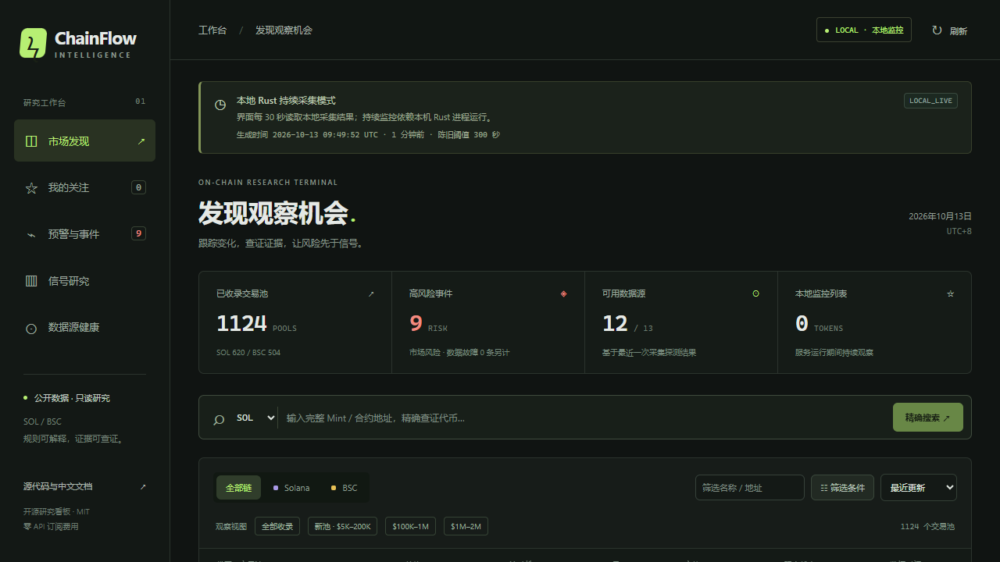

# ChainFlow Intelligence

**V1.1 · Rust / Web3 工程作品** · [公开看板](https://callmecx.github.io/chainflow-intelligence/) · [源码](https://github.com/Callmecx/chainflow-intelligence) · [CI](https://github.com/Callmecx/chainflow-intelligence/actions/workflows/ci.yml)

展示一条能真实运行的数据工程链路：**Tokio 异步采集 → 公开 RPC / 行情解析 → SQLite 单写入持久化 → 可解释监控状态机 → axum API → Vue 中文看板**。本机持续采集，GitHub Pages 提供免费公开快照。

V1.1 增量加入持久化 Telegram 队列、按正式信号冻结证据的 1h/2h/6h 研究、同源采样结构、独立数据故障分类及 Windows 长跑观察脚本。全部复用现有单进程架构，没有云服务器、付费 API、交易下单或私钥依赖。

**面试阅读入口：**[3 分钟演示与简历描述](docs/PORTFOLIO_GUIDE.md) · [Rust 架构及源码索引](docs/V1_1_ARCHITECTURE.md) · [V1.1 真实验收](docs/V1_1_ACCEPTANCE.md) · [效果统计定义](docs/SIGNAL_OUTCOMES.md) · [能力边界](docs/V1_1_LIMITATIONS.md)

本轮以核心可运行性、测试、短时 Canary、CI 和 Pages 为封版门槛。Telegram 实投、6h/24h 自然长跑没有证据时明确 PENDING；不因作品发布而宣称已验证。封版后停止功能扩展，不规划下一轮大型平台。



截图来自真实本机服务；已保存池数包含历史及陈旧池，不表示全网覆盖或全部同时新鲜。[完整真实代币案例](docs/REAL_TOKEN_CASE.md) 可核对地址、来源、采样及规则结果。

中文、只读、零付费的 SOL / BSC 公开行情研究终端。Rust 在本机持续采集并保存 SQLite 历史，Vue 看板解释观察规则和风险。公开网页由 GitHub Actions 定时生成真实快照，适合查看项目能力和当次公开数据。

**PUBLIC_SNAPSHOT = 半小时目标快照；LOCAL_LIVE = 本机服务持续轮询。** 数据失联、缺失字段、陈旧样本分别显示 `SOURCE_ERROR`、`UNKNOWN`、`STALE`。本项目不连接钱包、不接收私钥、不下单，也不承诺收益或全网新币覆盖。

V1 已发布历史证据：2026-10-13 验证 Pages HTTP 200、真实双链数据、桌面/手机详情及完整地址复制，并完成 15 分钟本机 Canary。该版本的 25 项 Rust、20 项前端单测、18 项浏览器场景见 [V1 验收](docs/ACCEPTANCE.md)；**V1.1 当前结果以 [V1.1 验收](docs/V1_1_ACCEPTANCE.md) 为准**，不复用旧版通过结论。本轮费用为 0。

直接打开公开网页即可查看当次快照；需要持续跟踪个人观察名单和积累历史时，按下面步骤运行本机服务。

## Windows 启动

需要免费工具：[Rust stable](https://rustup.rs/)、[Visual Studio C++ Build Tools](https://visualstudio.microsoft.com/visual-cpp-build-tools/)、[Node.js LTS](https://nodejs.org/en/download)、[Git](https://git-scm.com/downloads/win)。仅发布仓库时需要 [GitHub CLI](https://cli.github.com/)。安装 C++ 工具时选“使用 C++ 的桌面开发”及 Windows SDK。

在 PowerShell 中：

```powershell
Set-Location D:\ChainFlow-Intelligence
powershell -NoProfile -ExecutionPolicy Bypass -File .\scripts\windows\doctor.ps1
powershell -NoProfile -ExecutionPolicy Bypass -File .\scripts\windows\start.ps1
# 构建与依赖安装完成后，后续可用 -SkipBuild
# powershell -NoProfile -ExecutionPolicy Bypass -File .\scripts\windows\start.ps1 -SkipBuild
```

浏览器打开 `http://127.0.0.1:5178/chainflow-intelligence/`。Rust API 监听 `127.0.0.1:8787`；默认每 120 秒开始一次扫描，实际节奏受免费来源限流和网络情况影响。首次扫描完成前可能没有代币。查看“来源状态”确认数据是否成功获取。若 5178 已被占用，可给启动脚本传入 `-FrontendPort 5179`；脚本会设置相应回环 Origin，不会停止占用端口的其他项目。

关闭与诊断：

```powershell
powershell -NoProfile -ExecutionPolicy Bypass -File .\scripts\windows\stop.ps1
powershell -NoProfile -ExecutionPolicy Bypass -File .\scripts\windows\doctor.ps1
Get-Content .\logs\backend-*.error.log -Tail 40
```

脚本在后台隐藏窗口启动进程；记录 PID、启动时间、可执行文件和项目参数，停止时逐项核验。不会按进程名称批量杀死其他项目。工具可以放进 `.tools/cargo/bin`、`.tools/rust/bin`、`.tools/node`、`.tools/gh/bin`。已有便携工具目录可逐行写到本机 `.runtime/toolchain-path.txt`；该文件不提交。

## 功能与模式

| 能力 | 本机 LOCAL_LIVE | 公开 PUBLIC_SNAPSHOT |
| --- | --- | --- |
| SOL / BSC 发现、来源说明、筛选 | 当前本机采集结果 | 当次定时扫描结果 |
| 完整 Mint / 合约搜索 | 本地数据及真实 Provider 查询 | 仅搜索此次快照 |
| 观察名单 | SQLite 保存并参与持续监控 | 仅浏览器收藏，不触发后台监控 |
| 价格 / 流动性历史、风险、信号时间线 | 由后续真实采样逐步积累 | 单次作业可用信息，无连续历史保证 |
| 1h / 2h / 6h 观察结果 | 覆盖足够真实窗口后可计算 | 通常 UNKNOWN |
| 钱包交易、实盘、私钥 | 不支持 | 不支持 |
| Telegram | 可选持久队列与中文提醒；需本机配置 | 不读取配置、不发送通知 |

Telegram 配置见 [TELEGRAM_SETUP.md](docs/TELEGRAM_SETUP.md)；不需要在聊天中提供任何凭据。6h / 24h 运行脚本与报告见 [SOAK_RUN_GUIDE.md](docs/SOAK_RUN_GUIDE.md)，它们与 Codex 会话解耦，由用户选择启动。

行情字段来自 DEX Screener、GeckoTerminal；RPC 只做低频连通性/基础链状态验证。市值和 FDV 独立显示；未知不会填 0。买卖笔数不等于资金净流入。`BOOSTED` 表示推广收录。honeypot、持仓 Top10、聪明钱标签均为 `UNKNOWN`，不输出“安全币”判断。详见 [数据源](docs/DATA_SOURCES.md) 与 [能力边界](docs/LIMITATIONS.md)。

## 命令与配置

```powershell
# 已进入具备 Rust 与 MSVC 编译环境的终端
cargo run --locked --manifest-path backend/Cargo.toml -- scan-once --output data/snapshot.json
cargo run --locked --manifest-path backend/Cargo.toml -- serve --db data/chainflow.sqlite --port 8787 --interval-seconds 120
cargo run --locked --manifest-path backend/Cargo.toml -- doctor --db data/chainflow.sqlite
```

Windows 脚本会加载可选 `.env`。先把 `.env.example` 复制为 `.env`，按说明设置 `RUST_LOG` 和 `CHAINFLOW_RULES_JSON`。直接运行 Cargo 时需要自行设置进程环境变量。规则 JSON 的金额单位为 USD，时间窗口单位为秒；修改后重启本地服务。不要放入任何钱包私钥或未使用的第三方凭证。

API：`GET /api/health`、`/api/sources`、`/api/tokens`、`/api/tokens/{chain}/{address}`、`/api/signals`、`/api/metrics`、`/api/research`、`/api/watchlist`；本机观察名单写入为 `POST /api/watchlist`，删除为 `DELETE /api/watchlist/{chain}/{address}`。服务只监听回环地址，公开站点没有写接口。`scan-once` 默认创建独立临时数据库，显式 `--db` 也必须是新文件，拒绝导出已有本地历史。

## 验证与发布

```powershell
cargo fmt --manifest-path backend/Cargo.toml --all -- --check
cargo clippy --locked --manifest-path backend/Cargo.toml --all-targets -- -D warnings
cargo test --locked --manifest-path backend/Cargo.toml --all-targets
Set-Location frontend
npm.cmd ci
npm.cmd run typecheck
npm.cmd run lint
npm.cmd run test
npm.cmd run build
npx.cmd playwright install chromium
npm.cmd run test:e2e
```

Fixture 测试只验证代码行为，不能证明外部 API 可用。V1.1 的本地测试、真实 API、Canary、远端 CI 和实际 Pages 浏览器结果分别记录于 [当前验收](docs/V1_1_ACCEPTANCE.md)；[V1 验收](docs/ACCEPTANCE.md) 仅作为历史记录。

Pages 工作流在 `main` 推送、手动执行和每小时 UTC 第 17 / 47 分扫描。标准公开仓库 runner 运行短时任务，使用官方 Pages 构件部署；不会把快照写成 Git 提交。GitHub 调度可能延迟或跳过，前端展示实际 UTC 抓取时间与陈旧状态。Pages 不运行 Rust 后台。[发布操作与免费限制](docs/DEPLOYMENT.md)

更多文档：[架构](docs/ARCHITECTURE.md) · [规则](docs/SIGNAL_RULES.md) · [运维 / SQLite 备份](docs/RUNBOOK.md) · [许可证审计](docs/LICENSE_AUDIT.md)。本项目源码采用 [MIT](LICENSE)。
