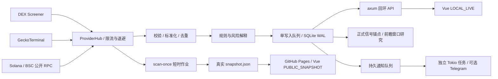

# 架构与数据契约

本文描述 V1.1 当前架构。项目采用单 Rust 进程、单 SQLite 数据库、单写入队列。Rust/Tokio 负责请求、采样、规则、研究、通知和 API；Vue 3/TypeScript/Vite 负责中文终端。无托管数据库、常驻云机器或付费 API。模块及迁移细节见 [V1_1_ARCHITECTURE.md](V1_1_ARCHITECTURE.md)。

## 数据身份与时间

- 唯一池身份为 `(chain, token_address, pool_address)`，链只接受 `solana` / `bsc`。BSC 地址大小写规范化；Solana 使用完整 mint，不能以 symbol 替代身份。
- 跨源同链同币同池去重；不同池保留独立记录。不得跨池相加 FDV 作为全球市值。
- 时间使用 RFC3339 UTC。每个样本有 `fetched_at`、source、source_url；快照有 `generated_at_utc`。
- USD 数据使用可空字段。MarketCap / FDV、未知 / 0、买卖笔数 / 资金流分别表达。
- 详细字段定义见 [CONTRACT.md](CONTRACT.md)。

## 采集与持久化

Provider 保留可替换接口与离线 fixture 回放入口。DEX、Gecko、RPC 通过 `tokio::join!` 并发等待；共享限流按来源约束请求。429 与所有 5xx 支持有上限的退避并尊重 `Retry-After`；403 不重试，超时、错误响应与空覆盖分别保留状态。单个来源失败不得生成假行情。源状态记录最近检查、最近成功、请求/错误数、连续失败、恢复次数和耗时。

本机 `serve` 周期扫描发现对象和观察名单，并把行情快照、规则状态、信号、研究锚点与通知入队在同一事务写入 SQLite。容量 64 的有界队列连接专用 SQLite 线程，Tokio 侧使用 `try_send` 与 oneshot，队列满时返回错误。WAL 配合单写入路径避免并发写冲突。幂等依靠池身份与采样时间；重复、乱序样本不应被当作新趋势。历史图为 `SAMPLED`，不是逐笔成交重建。

V1.1 增量 schema v2 保留原数据表，增加研究、来源健康与通知表。旧库迁移前先用 `VACUUM INTO` 生成一致性备份并检查完整性，拒绝打开更高版本数据库做降级。真实本地迁移证据见 [v1-1-migration-runtime.json](evidence/v1-1-migration-runtime.json)。

公开 `scan-once` 不传 `--db` 时创建唯一的临时数据库路径；显式 `--db` 必须指向尚不存在的新文件，否则拒绝执行。不同 Actions 运行不共享本机私有数据库、不继承个人观察名单，也不启动 Telegram 投递任务。公开快照不会形成连续 1h / 2h / 6h 研究历史，缺少完整窗口时保持未知或样本不足状态。

V1.1 正式确认信号冻结基准、规则版本与证据，再观察 1h / 2h / 6h；未到时点为 PENDING，缺失与删失分开统计，不补造历史。通知任务在数据库线程之外发送 HTTP，成功后再回写状态；中断导致的 UNCERTAIN 不自动重发。具体语义见 [SIGNAL_OUTCOMES.md](SIGNAL_OUTCOMES.md) 和 [TELEGRAM_SETUP.md](TELEGRAM_SETUP.md)。

## 服务与安全边界

API 默认固定回环 `127.0.0.1:8787`；Windows 脚本启动 Vite 监听 `127.0.0.1:5178`，代理 `/api`。脚本通过 `CHAINFLOW_FRONTEND_ORIGIN` 让后端允许相应回环来源；直接运行 Vite 的开发默认端口保持 5173。hash 详情路由兼容 GitHub Pages 子路径和刷新。PUBLIC_SNAPSHOT 只读取静态 JSON，无公网写接口。

本版本不提供账户、权限系统或公网 API 防护，不应将本地端口通过公网转发公开。`.env`、`.tools`、`.runtime`、日志、SQLite 和生成快照均被 Git 忽略。没有钱包、私钥、实盘交易链路。Telegram 默认关闭，凭据仅由本机服务读取；公开快照不含通知配置、个人观察名单或运行 PID。

## 可核验性

测试分为确定性的离线解析/规则/存储/API测试、前端单测/浏览器测试和真实网络验证。前两者不能替代实际行情连通性或长时间稳定性。发布和验收只在真实命令、CI、HTTP 证据存在后记为通过。PORTFOLIO_READY 封版不要求虚报尚未完成的 Telegram 实投或 6h/24h 长跑，这些项目保持 PENDING。当前汇总见 [V1_1_ACCEPTANCE.md](V1_1_ACCEPTANCE.md)。
