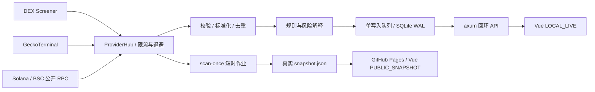

# 架构与数据契约

本项目采用单 Rust 进程、单 SQLite 数据库、单写入队列。Rust/Tokio 负责请求、采样、规则和 API；Vue 3/TypeScript/Vite 负责中文终端。无托管数据库、常驻云机器或付费 API。

## 数据身份与时间

- 唯一池身份为 `(chain, token_address, pool_address)`，链只接受 `solana` / `bsc`。BSC 地址大小写规范化；Solana 使用完整 mint，不能以 symbol 替代身份。
- 跨源同链同币同池去重；不同池保留独立记录。不得跨池相加 FDV 作为全球市值。
- 时间使用 RFC3339 UTC。每个样本有 `fetched_at`、source、source_url；快照有 `generated_at_utc`。
- USD 数据使用可空字段。MarketCap / FDV、未知 / 0、买卖笔数 / 资金流分别表达。
- 详细字段定义见 [CONTRACT.md](CONTRACT.md)。

## 采集与持久化

Provider 保留可替换接口与离线 fixture 回放入口。共享限流按来源约束请求；超时、429、503、403 与空覆盖以可区分状态呈现，尊重 `Retry-After`。单个来源失败不得生成假行情。源状态记录最近检查、最近成功、请求/错误数和耗时。

本机 `serve` 周期扫描发现对象和观察名单，并把行情快照、规则状态与信号写入 SQLite。WAL 配合单写入路径避免并发写冲突。幂等依靠池身份与采样时间；重复、乱序样本不应被当作新趋势。历史图为 `SAMPLED`，不是逐笔成交重建。

公开 `scan-once` 每次使用临时数据库；不同 Actions 运行不共享本机私有数据库、不继承个人观察名单。公开快照不会形成连续 1h / 2h / 6h 研究历史，缺少完整窗口时结果为 UNKNOWN。

## 服务与安全边界

API 默认固定回环 `127.0.0.1:8787`；Windows 脚本启动 Vite 监听 `127.0.0.1:5178`，代理 `/api`。脚本通过 `CHAINFLOW_FRONTEND_ORIGIN` 让后端允许相应回环来源；直接运行 Vite 的开发默认端口保持 5173。hash 详情路由兼容 GitHub Pages 子路径和刷新。PUBLIC_SNAPSHOT 只读取静态 JSON，无公网写接口。

本版本不提供账户、权限系统或公网 API 防护，不应将本地端口通过公网转发公开。`.env`、`.tools`、`.runtime`、日志、SQLite 和生成快照均被 Git 忽略。没有钱包、私钥、实盘交易链路；Telegram 未接入。

## 可核验性

测试分为确定性的离线解析/规则/存储/API测试、前端单测/浏览器测试和真实网络验证。前两者不能替代实际行情连通性或长时间稳定性。发布和验收只在真实命令、CI、HTTP 证据存在后记为通过。
