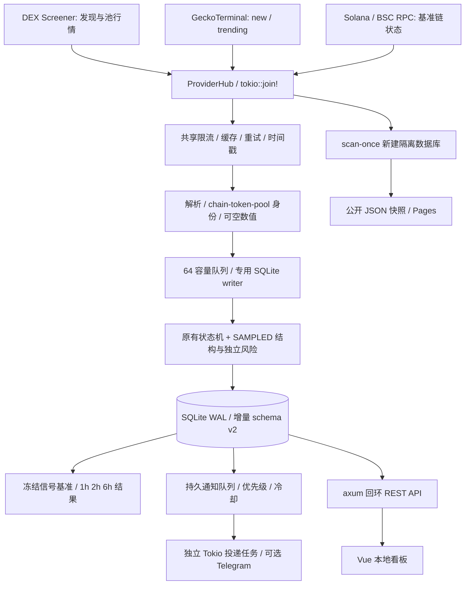

# V1.1 Rust 工程架构

项目定位为可真实运行的 Rust / Web3 求职作品；保留 V1 单进程、单 SQLite、单写入队列，不引入分布式组件。作品封版以核心运行、自动测试、短 Canary、CI 和公开网页为门槛；可选 Telegram 实投及长跑结果单独披露，不冒称已完成。

## 模块与并发

| 源码 | 职责 / 核心入口 |
|---|---|
| `backend/src/main.rs` | CLI、Tokio 扫描任务、独立通知任务、优雅退出、公开快照隔离 |
| `backend/src/providers/mod.rs` | `Provider` trait、`ProviderHub::scan` 的 `tokio::join!`、双链解析调度、只读 RPC |
| `backend/src/providers/http.rs` | 共享 reqwest Client、分源 `Mutex`、容量 1 令牌桶、超时、Retry-After、缓存 |
| `backend/src/providers/parsing.rs` | DEX / Gecko 实际响应映射，缺失值和身份归一 |
| `backend/src/models.rs` | 行情、历史点、状态事件及公开快照契约 |
| `backend/src/config.rs` | 金额、时间阈值、评分权重、研究容差的验证 |
| `backend/src/storage.rs` | `Store::call` 单 writer、事务写入、schema v2、备份、归档及统计 |
| `backend/src/engine.rs` | `evaluate` 状态转换、独立风险、确认与恢复规则 |
| `backend/src/structures.rs` | 同源采样的 3m / 5m / 15m 精度审查、结构证据、评分 |
| `backend/src/research.rs` | 信号基准注册、窗口冻结、删失统计、规则版本对照 |
| `backend/src/notifications.rs` | SQLite 队列、中文卡片、Transport、Telegram 安全投递与恢复 |
| `backend/src/api.rs` | 回环 API、Origin 校验、跟踪优先级、本机健康、研究接口 |

扫描任务以 Tokio interval 触发，漏掉的 tick 使用 Delay，不补发密集请求。一次扫描内 DEX、Gecko、RPC 并发；同来源的多个模块共享限流与缓存。`scan_lock` 防止精确查询与扫描争抢同一批次。自动跟踪按私人观察名单、待完成研究、确认候选和普通观察优先，同链最多 80 个跟踪地址，为发现请求保留预算。预算不代表全链覆盖。

SQLite 通过有界 `sync_channel(64)` 向专用线程传入工作闭包，Tokio 侧 `try_send` 后等待 oneshot；不会把慢磁盘直接放在 Tokio 工作线程。采样、视图、信号、研究锚点与通知入队在同一事务提交。HTTP 发送在数据库线程之外，完成后再提交投递状态；网络与数据库之间无法保证绝对 Exactly Once。

## 时间、风险与研究

`fetched_at` / `source_at` 表示本机取得来源响应的 UTC 时间，不冒称链上成交时间；缓存命中保留原时间。新结构要求同源、同链、同 token、同 pool 的有序有效样本。默认 120 秒轮询不能支撑精细 3m K 线，显示 `INSUFFICIENT_RESOLUTION`。市场风险与 `DATA_FAULT` 分别计数；RPC 故障不会推断为撤资。

正式信号持久化基准价格、流动性、完整证据、规则版本及配置指纹。每个信号独立跟踪 1h / 2h / 6h，结果状态与统计定义见 [SIGNAL_OUTCOMES.md](SIGNAL_OUTCOMES.md)。V1 历史记录保留，不能事后制造 V1.1 前瞻信号。

## 持久化与迁移

保留 `samples/views/signals/meta/watchlist`，增量增加 `signal_research/source_health/notification_queue/notification_attempts/notification_control`。迁移前使用 SQLite `VACUUM INTO` 制作一致性备份并检查 integrity；不复制活跃数据库主文件冒充完整备份。`PRAGMA user_version=2`；新 JSON 字段具备 serde 默认值，旧视图可读取。拒绝较新 schema 的降级打开。

## 安全发布边界

服务固定监听 `127.0.0.1`，公开站无本地写入口。`scan-once` 使用新建隔离数据库，拒绝把已有数据库作为公开扫描输入；GitHub Actions 只发布临时公开行情，未配置通知任务。公开 JSON 不含 Telegram 配置、私人观察名单、运行 PID 或本地数据库。Telegram API URL 中含 token，因此运输错误只保存固定分类码，HTTP 库调试日志关闭。

## 复用说明

本轮复用了 V1 的 reqwest/Tokio 采集、Provider trait、解析器、RPC 探测、限流缓存、SQLite 单 writer、WAL、REST 路由、Vue 页面和 Pages 工作流；新增模块围绕这些边界接入。没有更换数据源体系，也没有引入 Kafka、额外数据库或常驻云服务。
